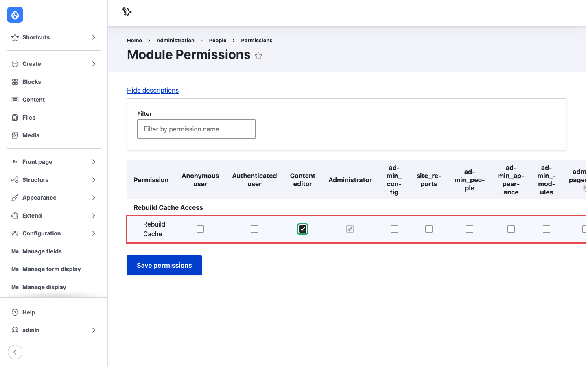
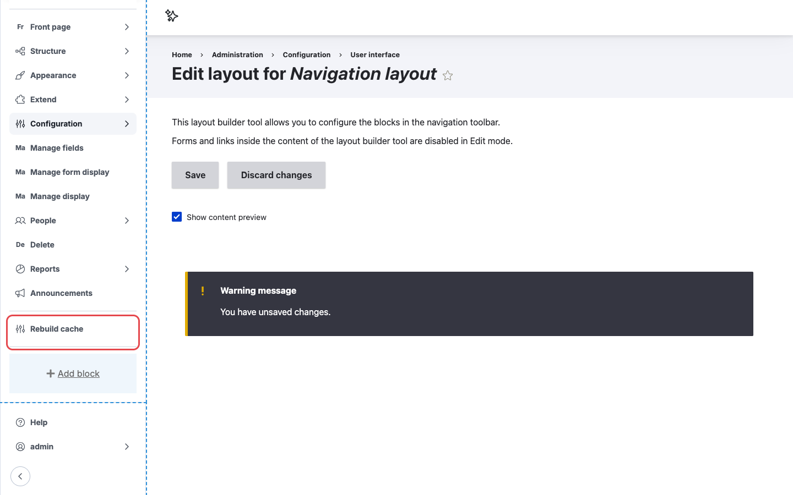

# Configuration

The module has one setting: who is allowed to rebuild caches. You control it with a permission.

## Grant the permission

1. Go to **People > Permissions** (`/admin/people/permissions`), or open the module's own
   permission page at `/admin/people/permissions/module/rebuild_cache_access`.
2. Find **Rebuild Cache** under **Rebuild Cache Access**.
3. Check it for each role that should see the button, for example **Content editor**.
4. Click **Save permissions**.

/// caption
Granting **Rebuild Cache** to the Content editor role.
///

## Users also need access to the admin navigation

The button lives in the admin navigation, so a role needs permission to see that navigation too:

| Your site uses | The role also needs |
|---|---|
| Core Navigation sidebar | `Access navigation bar` (`access navigation`) |
| Classic core Toolbar | `Use the toolbar` (`access toolbar`) |

A role with **Rebuild Cache** but without one of these permissions does not see the button.

!!! tip
    Navigation hides the classic Toolbar once it is enabled. If you switch a site from Toolbar to
    Navigation, check that your editor roles have `access navigation`; roles that only had
    `access toolbar` lose their admin menu, including the Rebuild cache link.

## Who should get the permission

A full cache rebuild is expensive. Every cache on the site is emptied, and the next requests
rebuild them from scratch, which makes the site slower for everyone until the caches warm up
again. On a large site this can take noticeable time.

The permission is therefore marked as restricted, so the permissions page shows the
*Warning: Give to trusted roles only; this permission has security implications.* note next to it.

- Grant the permission to trusted roles that need it, such as editors or site managers.
- Do not grant it to **Anonymous user** or **Authenticated user**. Anyone with the permission can
  slow the site down by clicking the button repeatedly.

## Placing the Navigation block by hand

The module adds the Navigation block when Navigation is installed. If the block is missing, for
example because someone removed it, or you want it in a different position:

1. Go to **Configuration > User interface > Navigation blocks**
   (`/admin/config/user-interface/navigation-block`).
2. Click **Enable edit mode**.
3. Click **Add block**, choose **Rebuild cache**, and save the block.
4. Drag it where you want it and click **Save**.

/// caption
The **Rebuild cache** block in the Navigation layout editor.
///

The block is only available in the Navigation layout. It does not appear in the regular
**Block layout** page, because it only renders correctly inside the Navigation sidebar.

You can change the block label in its settings, for example to "Clear caches". The label is what
users see in the sidebar.
