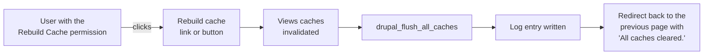

# Rebuild Cache Access

Rebuild Cache Access adds a **Rebuild cache** button to the Drupal admin interface and a
permission that controls who sees it. Give the permission to any role, and users with that role
can clear all caches in one click, without the `administer site configuration` permission and
without Drush.

/// caption
The **Rebuild cache** link at the bottom of the Navigation sidebar.
///

## When to use it

Drupal clears the relevant caches on its own when content or configuration changes. Sometimes
that is not enough: a content editor changes a menu or a block and the old version keeps showing,
or a marketing team needs to see a change right away. Normally only site administrators can clear
caches, from **Configuration > Development > Performance**. This module lets you hand that single
action to other roles without giving them access to site configuration.

## Features

- A `Rebuild Cache` permission you can grant to any role.
- A **Rebuild cache** link in the core Navigation sidebar, added automatically.
- A **Rebuild Cache** button in the classic core Toolbar, for sites that do not use Navigation.
- A confirmation message after the caches are cleared, and the user lands back on the page they
  were on.
- A log entry for every rebuild, so you can see who cleared the caches and when.
- CSRF protection on the rebuild link, so nobody can trigger a rebuild by sending a user a link.

## How it works

The button runs the same full cache rebuild as the **Clear all caches** button on the Performance
page and `drush cache:rebuild`.

## Quick start

1. Install the module: `composer require drupal/rebuild_cache_access` and
   `drush en rebuild_cache_access`.
2. Go to **People > Permissions** and grant **Rebuild Cache** to the roles that need it.
3. Users with that role see **Rebuild cache** in their admin navigation. Clicking it clears all
   caches.

See [Installation](installation.md) and [Configuration](configuration.md) for details.

## Compatibility

| | |
|---|---|
| Drupal core | 10.1 and later, 11, 12 |
| Required modules | None (Navigation or Toolbar is needed to show the button) |
| Supported admin navigation | Core Navigation module and core Toolbar |
