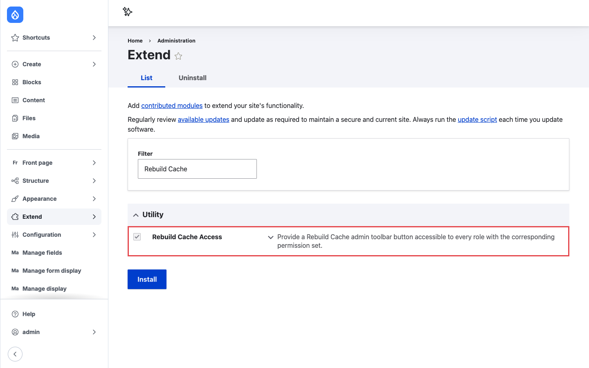

# Installation

## Requirements

- Drupal 10.1 or later, Drupal 11, or Drupal 12.
- One of the core admin navigation modules, so users have somewhere to see the button:
    - **Navigation**, for the link in the Navigation sidebar.
    - **Toolbar**, for the button in the classic top bar.

The module does not have a dependency on the Toolbar module, but needs either Toolbar or
Navigation to show the Rebuild cache button. It does not enable Toolbar on sites that only use
Navigation. Without either module, the permission can be granted but the button is shown nowhere.

## Install with Composer and Drush

```bash
composer require drupal/rebuild_cache_access
drush en rebuild_cache_access
```

## Install from the admin UI

1. Download the module with Composer as shown above.
2. Go to **Extend** (`/admin/modules`).
3. Type `Rebuild Cache` in the **Filter** field.
4. Check **Rebuild Cache Access** under **Utility** and click **Install**.


/// caption
Rebuild Cache Access is listed in the **Utility** group on the Extend page.
///

## What happens on install

- The `Rebuild Cache` permission becomes available on the permissions page. No role gets it by
  default except **Administrator**, which has all permissions.
- If the Navigation module is enabled, the module adds a **Rebuild cache** block to the Navigation
  layout. If you enable Navigation later, the block is added at that point. If the block is
  missing, see [Placing the Navigation block by hand](configuration.md#placing-the-navigation-block-by-hand).
- Nothing else changes. The module has no settings form and stores no configuration of its own.

!!! note "Config sync"
    On sites deployed with configuration management, the Navigation layout comes from your
    exported `navigation.block_layout` configuration. Enable the module on a development site,
    check the block is in the layout, and export the configuration so every environment gets it.

## Updating from an older version

Version 8.x-1.13 ships update hook `rebuild_cache_access_update_11001`, which adds the Navigation
block on sites that already had both modules enabled. Run database updates after updating the
code:

```bash
drush updatedb
```

### Toolbar is no longer required

Older versions required the core Toolbar module, so updating does not uninstall Toolbar for you.
If your site uses Navigation and you only kept Toolbar for this module, you can uninstall it after
updating:

```bash
drush pm:uninstall toolbar
```

This also removes the **Toolbar and Navigation modules are both installed** warning from the
status report. On sites deployed with configuration management, uninstall Toolbar on a
development site and export the configuration, so `core.extension` and the roles are updated on
every environment.

!!! warning "Check what else uses Toolbar"
    Other modules can depend on Toolbar, for example Admin Toolbar or Gin Toolbar. Drush then
    asks to uninstall them together with Toolbar, in one confirmation. If you still need any of
    them, cancel and keep Toolbar. Uninstalling Toolbar also removes the **Use the toolbar**
    (`access toolbar`) permission from all roles.

If an install profile, recipe, or deployment script relied on this module to enable Toolbar, add
`toolbar` to it explicitly.

## Uninstalling

```bash
drush pm:uninstall rebuild_cache_access
```

Uninstalling removes the permission from all roles, and the button disappears from the Toolbar
and the Navigation sidebar. The **Rebuild cache** block is removed from the Navigation layout,
so reinstalling the module later adds it again only once. A changed label or position of the
block is not kept: after reinstalling, the block comes back with its default label and position.

!!! note "Config sync"
    When the module is uninstalled by `drush config:import`, the Navigation layout is not
    changed; the imported `navigation.block_layout` wins. Uninstall the module on a development
    site and export the configuration, so the exported layout no longer contains the block.
