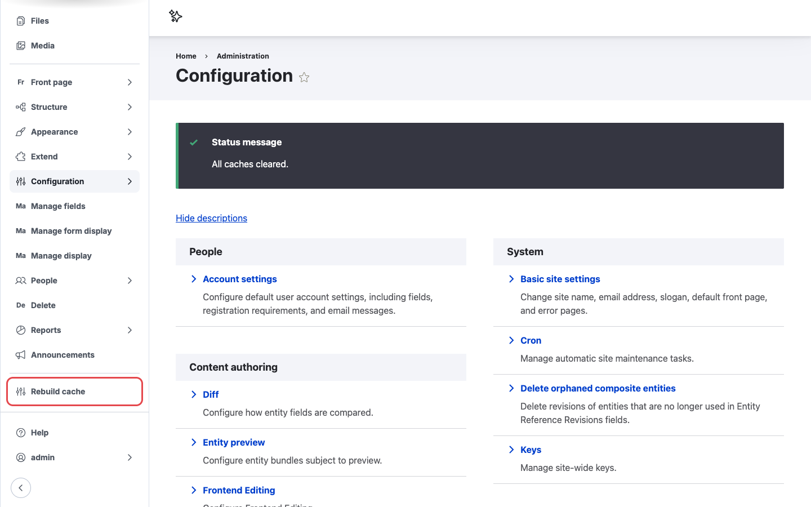
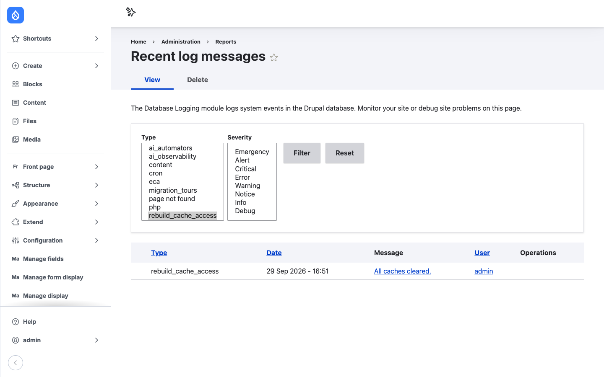

# Clearing caches

Where the button appears depends on which admin navigation your site uses:

- **Navigation sidebar** (core Navigation module): a **Rebuild cache** link near the bottom of the
  sidebar. See
  [Navigation sidebar](navigation.md).
- **Classic Toolbar** (core Toolbar module): a **Rebuild Cache** button with a recycle icon in the
  black top bar. See [Classic toolbar](toolbar.md).

In both cases the steps are the same:

1. Open any page on the site while logged in.
2. Click **Rebuild cache**.
3. Wait for the page to reload. This takes a few seconds on most sites, longer on large ones.
4. You return to the page you were on, with the message **All caches cleared.**

/// caption
You land back on the same page with a confirmation message.
///

## What gets cleared

The button runs a full cache rebuild, the same as:

- **Clear all caches** on **Configuration > Development > Performance**
- `drush cache:rebuild`

That covers rendered pages and blocks, Views results, menus, routes, theme registry, and compiled
CSS and JavaScript aggregates. Content and configuration are not touched.

## Checking who cleared the caches

Each rebuild writes an **Info** entry with the message `All caches cleared.` to the site log, under
the type `rebuild_cache_access`. With the core Database Logging module enabled:

1. Go to **Reports > Recent log messages** (`/admin/reports/dblog`).
2. In **Type**, select `rebuild_cache_access` and click **Filter**.

The **User** column shows who clicked the button.

/// caption
Every rebuild is logged with the user who triggered it.
///
