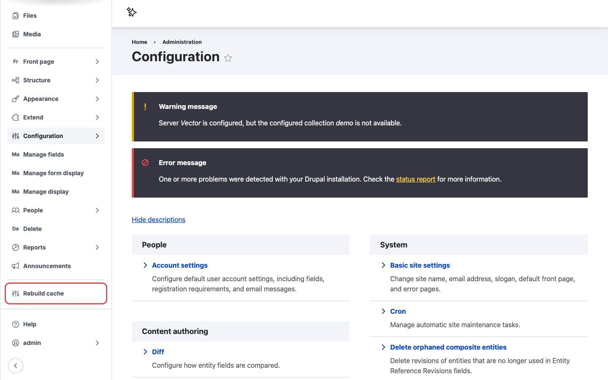
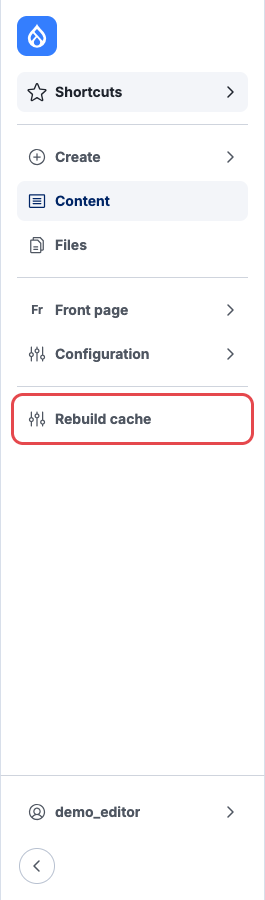

# Navigation sidebar

On sites with the core Navigation module, the module adds a **Rebuild cache** link to the
sidebar, just above **Help** and the user menu.

{ width="200" }

/// caption
Left: an administrator's sidebar. Right: a content editor with only a few admin permissions sees
the same link.
///

## Steps

1. Log in with a user whose role has the **Rebuild Cache** and **Access navigation bar** permissions.
2. If the sidebar is collapsed, expand it with the arrow button at the bottom, or hover over the
   icons.
3. Click **Rebuild cache**.
4. The page reloads with the message **All caches cleared.**

On long menus you may need to scroll the sidebar to see the link.

## The link is missing

- Check the role has both **Rebuild Cache** and **Access navigation bar**.
- Check the block is still in the Navigation layout. See
  [Placing the Navigation block by hand](../configuration.md#placing-the-navigation-block-by-hand).
