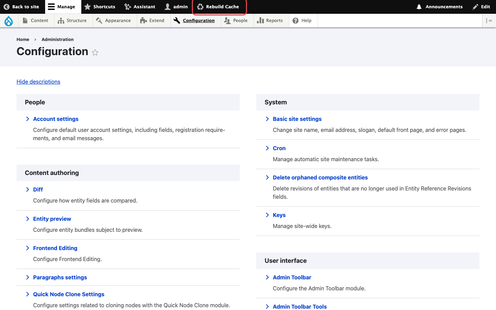
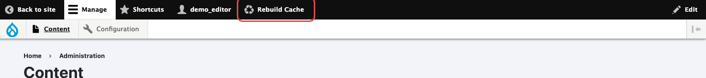
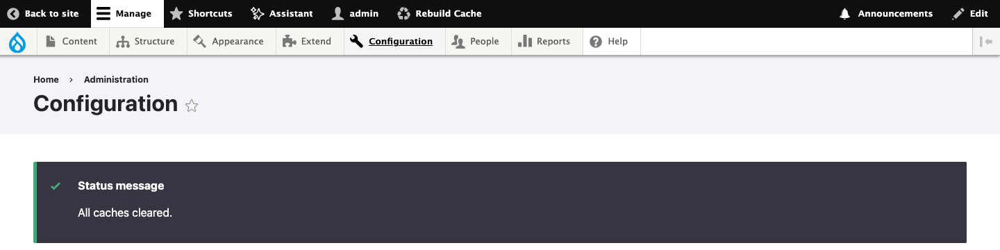

# Classic toolbar

On sites that use the core Toolbar without the Navigation module, the module adds a
**Rebuild Cache** button with a recycle icon to the black top bar.

/// caption
The **Rebuild Cache** button in the administrator's toolbar.
///

The button shows up for every role with the permission, including roles with a very small admin
menu:

/// caption
A content editor with the **Rebuild Cache** permission.
///

## Steps

1. Log in with a user whose role has the **Rebuild Cache** and **Use the toolbar** permissions.
2. Click **Rebuild Cache** in the top bar.
3. The page reloads with the message **All caches cleared.**

/// caption
The confirmation message after a rebuild from the toolbar.
///

!!! note
    When the Navigation module is enabled, Drupal hides the classic Toolbar and this button with
    it. Use the [Navigation sidebar](navigation.md) link instead.
